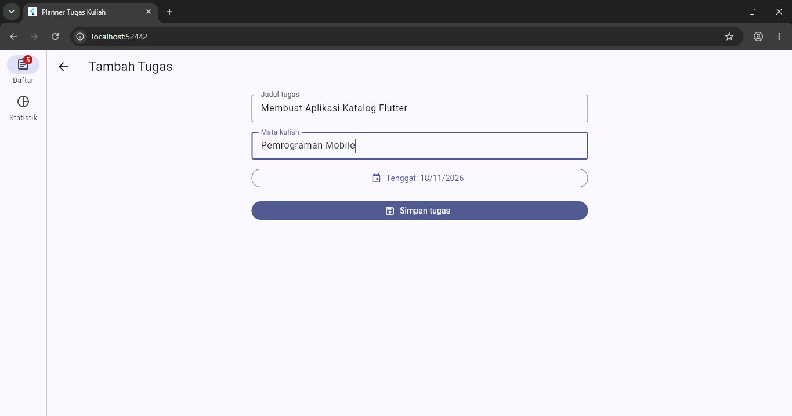
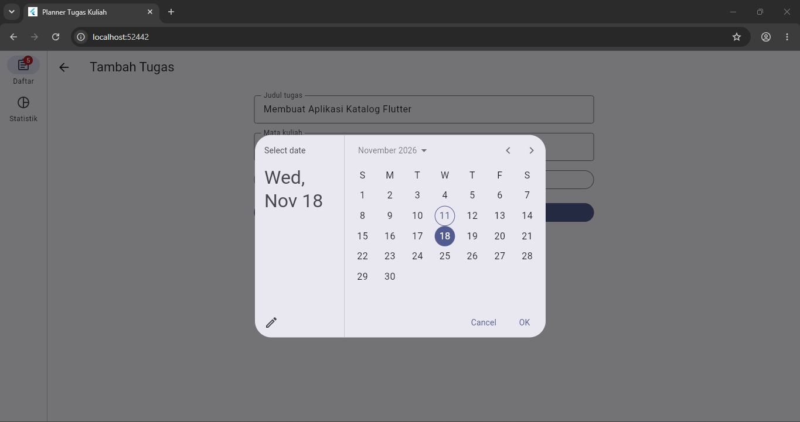
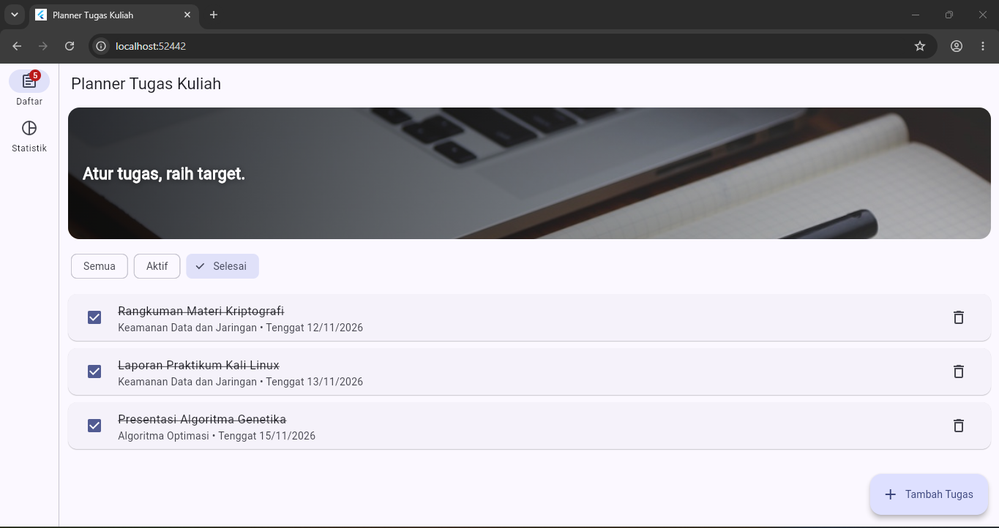
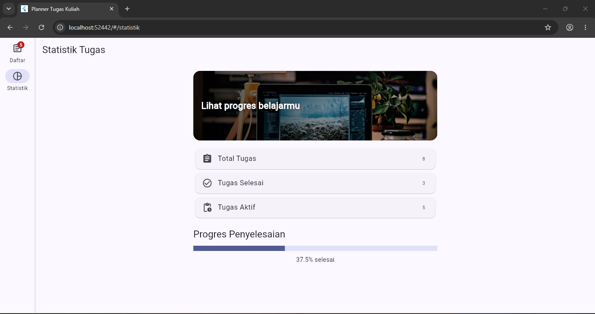
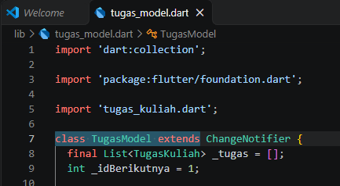
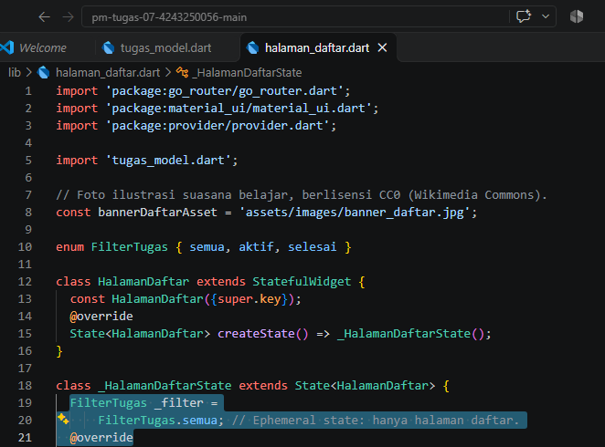
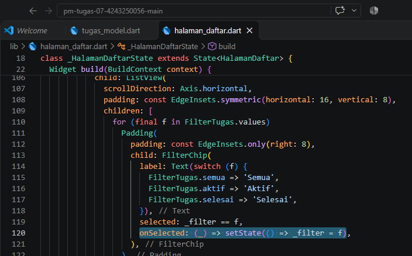
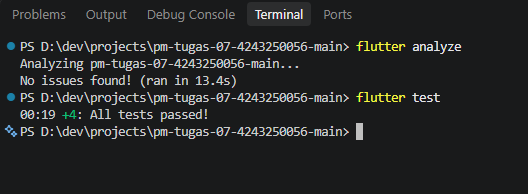

# Tugas Rutin 7 — Planner Tugas Kuliah

**Micael Zecsen Saragih | NIM 4243250056 | PSIK 24 D | Ilmu Komputer UNIMED**

Aplikasi Flutter Planner Tugas Kuliah untuk mengelola judul tugas, mata kuliah, tenggat, dan status selesai. Menggunakan **Provider/ChangeNotifier** sebagai app state dan **setState** untuk filter halaman daftar. Tidak mengirim data ke backend atau melakukan penyimpanan permanen.

## Fitur
- Daftar tugas dengan filter Semua, Aktif, Selesai (FilterChip).
- Dua banner foto tersimpan lokal di `assets/images/` dan dilengkapi fallback ikon jika aset tidak ditemukan.
- Form tambah tugas dengan validasi dan pemilih tanggal.
- Menandai selesai dan menghapus tugas.
- Statistik total, selesai, aktif dan persentase otomatis.
- Badge jumlah tugas aktif; NavigationBar pada mobile dan NavigationRail pada desktop.
- Navigasi go_router `/`, `/tambah`, `/statistik`.
- Tiga unit test tanpa UI.

## Peta state

```text
ChangeNotifierProvider<TugasModel> [STATE BERSAMA]
 ├── PlannerShell: badge jumlahAktif (context.select)
 ├── HalamanDaftar: daftar tugas (context.watch)
 │    └── FilterTugas [STATE LOKAL: setState]
 ├── HalamanTambah: form
 │    ├── TextEditingController x2 [STATE LOKAL, lifecycle]
 │    └── tanggal terpilih [STATE LOKAL: setState]
 └── HalamanStatistik: nilai agregat (context.watch)
```

## Lifecycle dan pilihan state management (150–250 kata)

Aplikasi Planner Tugas Kuliah memisahkan state berdasarkan cakupan penggunaannya. Filter Semua, Aktif, dan Selesai hanya dibutuhkan oleh halaman daftar. Oleh karena itu, nilai filter disimpan dalam StatefulWidget dan diperbarui melalui setState. Cara ini sederhana dan tidak membuat halaman lain ikut menyimpan pilihan filter. Form tambah tugas juga menggunakan StatefulWidget karena nilai input dan tanggal diproses sementara sebelum tugas disimpan.

Pada initState, dua TextEditingController dibuat untuk menampung judul dan nama mata kuliah. Keduanya dipakai selama pengguna mengisi formulir, kemudian wajib dibersihkan dalam dispose ketika halaman ditutup. Pembersihan tersebut mencegah kebocoran sumber daya. Pemilihan tanggal bersifat asinkron; setelah proses selesai, pemeriksaan mounted dilakukan sebelum setState, sebab pengguna mungkin sudah meninggalkan halaman.

Daftar tugas merupakan state bersama karena halaman daftar, statistik, dan badge navigasi membutuhkan data yang konsisten. Saya memilih Provider dengan ChangeNotifier agar logika tambah, tandai selesai, dan hapus dipisahkan dari tampilan, tetapi tetap mudah dipahami pada skala tugas kuliah. notifyListeners memberi tahu widget yang mendengarkan perubahan. Halaman statistik menggunakan context.watch untuk memperoleh data terbaru, sedangkan badge memakai context.select agar memantau jumlah tugas aktif saja. Pemisahan ini membuat kode lebih terstruktur dan logika dapat diuji melalui unit test tanpa memerlukan antarmuka Flutter.

## Foto dan Sumber

Kedua foto ilustrasi ruang belajar telah disimpan sebagai **aset lokal** dan didaftarkan melalui `pubspec.yaml`. Halaman Daftar menggunakan `assets/images/banner_daftar.jpg` (karya Eric Bailey), sedangkan halaman Statistik menggunakan `assets/images/banner_statistik.jpg` (karya Radek Grzybowski). Keduanya dicatat sebagai CC0 1.0 dalam [dokumen kredit foto](docs/KREDIT_FOTO.md). Banner ditampilkan melalui `Image.asset`, `BoxFit.cover`, overlay gradasi, dan fallback ikon; tampilan tidak lagi memerlukan jaringan untuk mengunduh gambar.

## Dokumentasi Hasil Praktikum

Semua gambar berikut berasal dari screenshot yang sudah diunggah ke folder `docs/`. Data tugas pada screenshot digunakan sebagai **contoh untuk demonstrasi**, bukan daftar tenggat resmi mata kuliah.

### 01. Daftar Tugas
Halaman utama berisi kartu tugas, filter, banner ilustrasi, status selesai, dan tombol tambah.


### 02. Form Tambah Tugas
Form pengisian judul, mata kuliah, dan tenggat dengan validasi input.



### 03. Pemilihan Tenggat (DatePicker)
Dialog kalender untuk memilih tanggal tenggat, dengan pembaruan state lokal.



### 04. Filter Status Tugas
Hasil penerapan `FilterChip` untuk status Semua, Aktif, dan Selesai.



### 05. Statistik Penyelesaian
Jumlah tugas total, selesai, aktif, serta progress bar persentase yang dihitung dari data model.



### 06. Bukti Implementasi State Management
Tiga screenshot kode berikut memperlihatkan perbedaan **state lokal** dan **state bersama**.

**6.1 — Deklarasi state lokal:** `FilterTugas` dan `_filter` dalam `StatefulWidget`.



**6.2 — Pemanggilan `setState()`:** perubahan filter melalui `onSelected` pada `FilterChip`.



**6.3 — Pengelola state bersama:** `TugasModel extends ChangeNotifier`; pemanggilan `notifyListeners()` terdapat dalam metode tambah, tandai selesai, dan hapus di [`lib/tugas_model.dart`](lib/tugas_model.dart).



### 07. Bukti Analisis dan Pengujian
Screenshot terminal `flutter analyze` dan `flutter test` dari komputer mahasiswa.



## Pengujian

Unit test dalam `test/tugas_model_test.dart` memeriksa tiga skenario:
1. Menambah tugas memperbarui jumlah total dan tugas aktif.
2. Menandai tugas selesai memperbarui persentase.
3. Menghapus tugas mengurangi jumlah total tanpa menghapus tugas lain.

Hasil perintah pada komputer mahasiswa didokumentasikan dalam screenshot nomor 07. Repository ini telah diperiksa untuk keberadaan source, aset, dan bukti, **bukan** dijalankan ulang dengan Flutter SDK melalui GitHub.

## Struktur Project

```text
pm-tugas-07-4243250056/
├── lib/
│   ├── main.dart
│   ├── tugas_kuliah.dart
│   ├── tugas_model.dart
│   ├── halaman_daftar.dart
│   ├── halaman_tambah.dart
│   └── halaman_statistik.dart
├── assets/images/
│   ├── banner_daftar.jpg
│   └── banner_statistik.jpg
├── test/tugas_model_test.dart
├── docs/
│   ├── 01-daftar-tugas.png
│   ├── 02-form-tambah.png
│   ├── 03-date-picker.png
│   ├── 04-filter-tugas.png
│   ├── 05-statistik-tugas.png
│   ├── 06-1-state-lokal.png
│   ├── 06-2-setstate.png
│   ├── 06-3-changenotifier.png
│   ├── 07-analyze-test.png
│   └── KREDIT_FOTO.md
├── pubspec.yaml
└── README.md
```

## Cara menjalankan

```powershell
flutter pub get
flutter analyze
flutter test
flutter run -d chrome
```

Jika folder platform Flutter belum tersedia, jalankan satu kali: `flutter create --org id.ac.unimed --project-name pm_tugas_07_4243250056 .` sebelum `flutter run`.

Seluruh screenshot tugas sudah tersedia dan ditampilkan pada bagian dokumentasi di atas. Untuk lingkungan Flutter Web yang mengalami kendala koneksi ke CDN/debugger, mode release dengan aset web lokal dapat dicoba menggunakan `flutter run -d chrome --release --no-web-resources-cdn` (jika opsi didukung versi Flutter).

## Pernyataan AI

AI membantu penyusunan source code dan README; mahasiswa memeriksa dan menjalankan program, pengujian, serta dokumentasi akhir secara langsung.
